# RefCard05 – Full-Stack auf AWS: Ergebnis

**Repositories**
- Frontend: https://github.com/rtinase/refcard05-fe
- Backend (inkl. Docker Compose und AWS-Skripte): https://github.com/rtinase/refcard05-be
- Docker Compose für die lokale Entwicklung: [`docker-compose-local/`](../docker-compose-local/README.md) (im Backend-Repo)

**Live (AWS Academy Learner Lab, us-east-1, solange die Lab-Session läuft)**
- Frontend: http://refcard05-fe-alb-400588137.us-east-1.elb.amazonaws.com
- Backend: http://refcard05-be-alb-848783508.us-east-1.elb.amazonaws.com/actuator/health

Ich habe beide Repositories aus dem Ausgangszustand `v1-start` der Vorgabe neu aufgebaut. Alle AWS-Ressourcen habe ich in einem neuen Learner Lab selbst angelegt.

---

## 1. Überblick

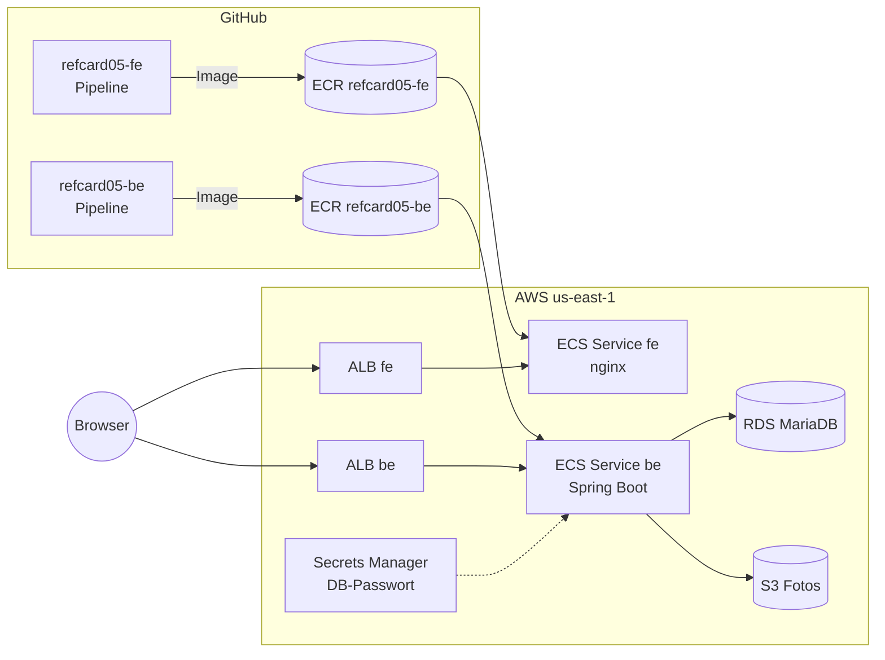

| Aufgabe | Umsetzung | Nachweis |
|---|---|---|
| 1 Zwei Repos mit CI/CD | je Repo `.github/workflows/ci-cd.yml`: Build/Test → Image → ECR → ECS | Abschnitt 2, 3 |
| 2 RDS und S3 | RDS MariaDB über Umgebungsvariablen/Secrets Manager, Fotos in S3 mit Least-Privilege-Policy | Abschnitt 4, 5 |
| 3 ECS, zwei Services | zwei Fargate-Services, automatisches Redeploy, Learner-Lab-Credentials als Secrets | Abschnitt 6, 7 |
| 4 Lokal zusammenführen | Docker Compose im Backend-Repo | Abschnitt 8 |

---

## 2. CI/CD-Pipeline (beide Repos)

Pro Repo eine eigene Pipeline mit denselben Jobs:

| Job | Frontend | Backend |
|---|---|---|
| Build und Test | `npm ci`, ESLint, Vitest, `vite build` | `mvnw verify` (JUnit, H2) |
| Image | Docker Buildx, Vite-Build hinter nginx | Docker Buildx, Maven → JRE 21 Alpine, Non-Root |
| Deploy | Task-Definition rendern, ECS-Service aktualisieren, Smoke-Test | dasselbe, Smoke-Test prüft `/actuator/health` = UP |

Damit die Pipeline robust und nachvollziehbar bleibt:
- **Caching:** npm- bzw. Maven-Cache (`setup-node`/`setup-java`), Docker-Layer-Cache über GitHub Actions (`cache-from/cache-to: type=gha`).
- **`concurrency`:** pro Branch/Tag läuft nur ein Run, ein neuer Push bricht den alten ab.
- **`paths-ignore`:** reine Doku-Änderungen (`docs/**`, `*.md`) lösen keinen Deploy aus.
- **Klare Meldungen:** fehlen die AWS-Secrets, gibt die Pipeline eine Warnung aus und baut das Image nur (statt unklar zu scheitern). Fehlende GitHub-Variablen stoppen den Deploy-Job mit einer Fehlermeldung, die den Fix nennt.
- **Job Summary:** Testergebnis, Image-Tags und deployte Version stehen im Run.
- **Deploy nur von `main` und Release-Tags**, nie von Pull Requests.

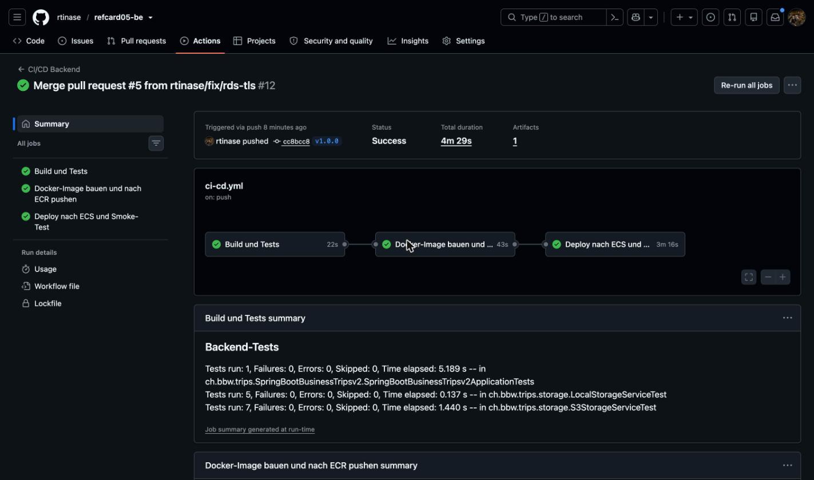
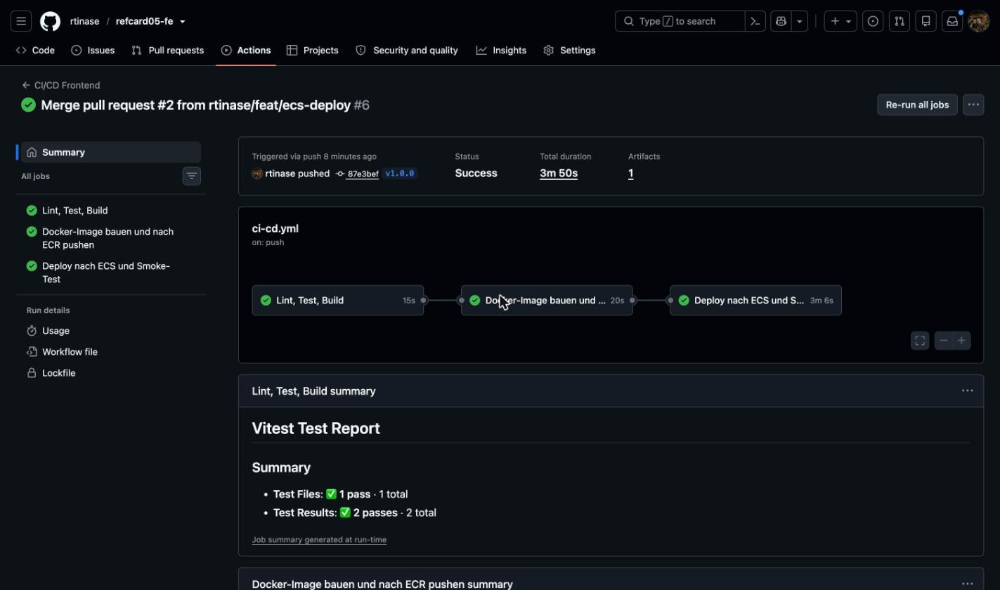
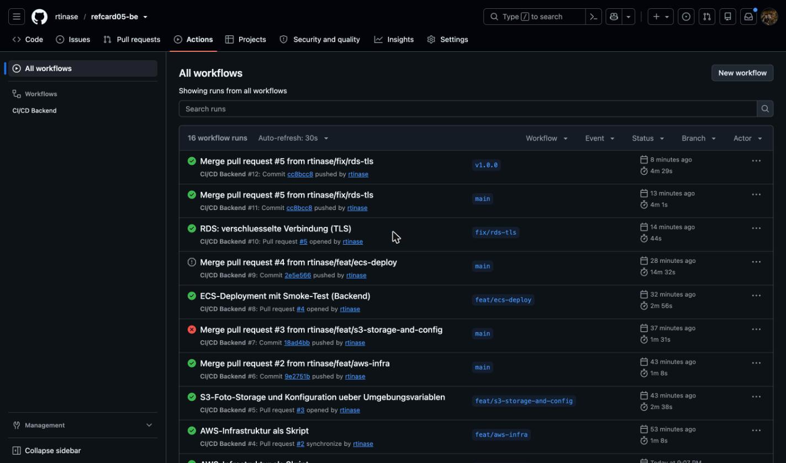
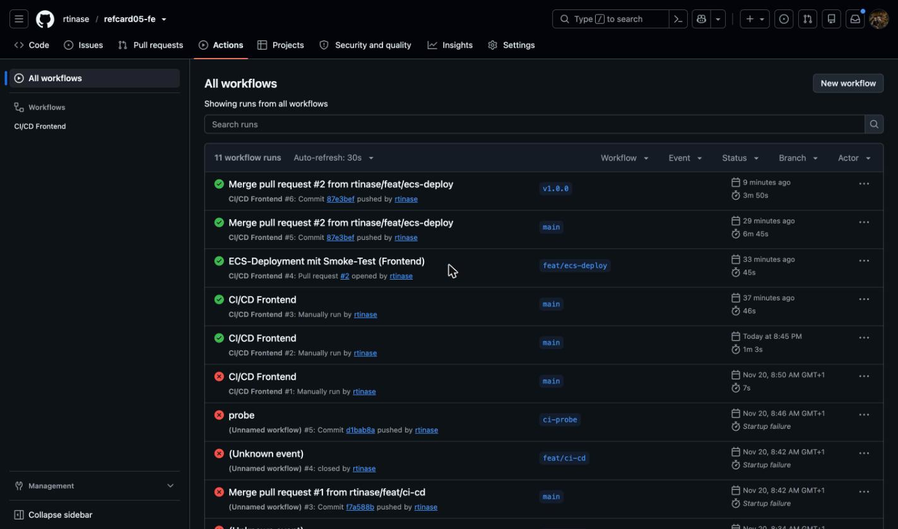

---

## 3. Versionierung mit Git-Tags

Beide Repos verwenden dasselbe Schema (SemVer): ein Tag `vMAJOR.MINOR.PATCH` löst die Pipeline aus. Der Tag bestimmt die Image-Bezeichnung in ECR (`docker/metadata-action`):

| Ereignis | Image-Tags in ECR |
|---|---|
| Tag `v1.1.0` | `1.1.0`, `sha-<Commit>` |
| Push auf `main` | `sha-<Commit>`, `latest` |

Deployt wird immer der unveränderliche `sha-…`-Tag, nie `latest`. So ist jederzeit nachvollziehbar, welcher Commit läuft.

| Release | Frontend (Commit) | Backend (Commit) | Änderung |
|---|---|---|---|
| `v1.0.0` | `87e3bef` | `cc8bcc8` | erster vollständiger Stand auf AWS |
| `v1.1.0` | `09622d1` | `1fa7ec0` | FE: nginx-Security-Header · BE: Compose, Upload-Verzeichnis für Non-Root |

Die API ist mit `/v1` versioniert; Frontend `1.x` arbeitet mit Backend `1.x` zusammen. ECR-Repositories sind absichtlich *mutable*, weil `latest` verschoben wird.

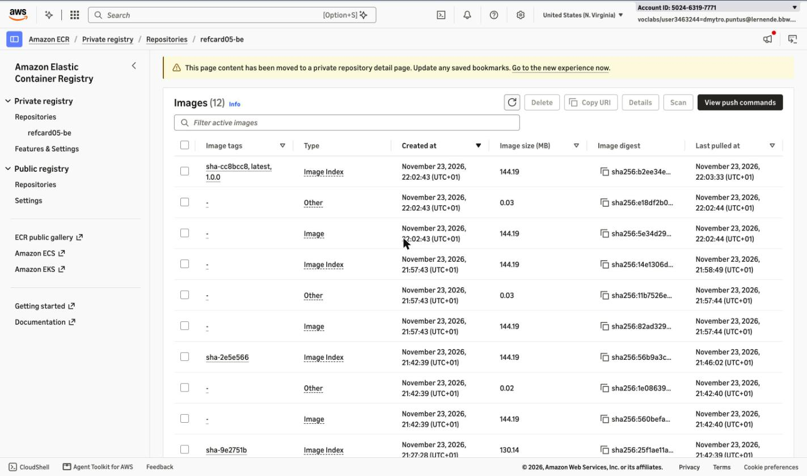
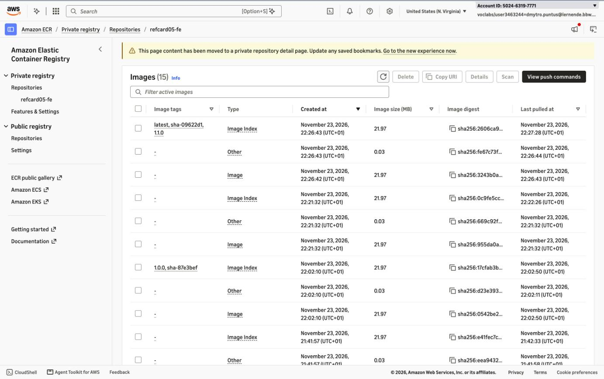
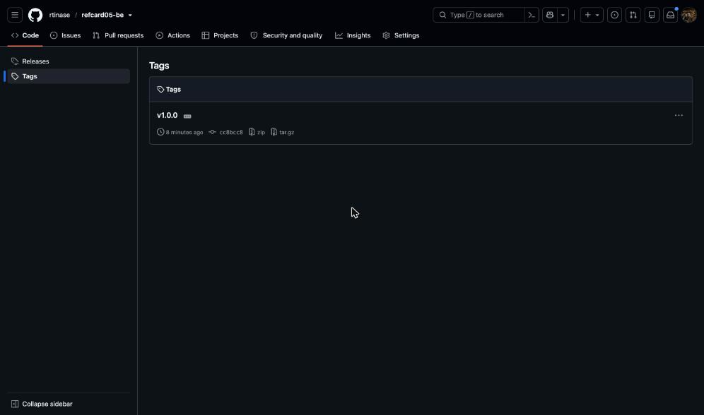
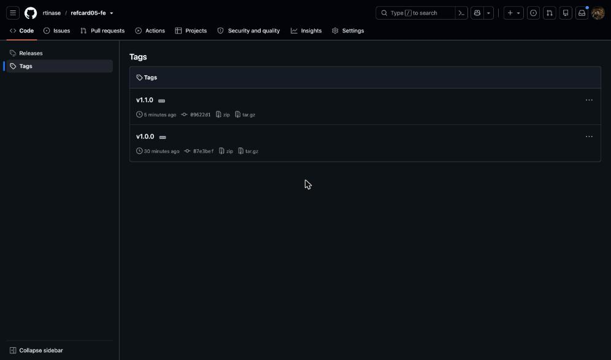

---

## 4. Backend und Amazon RDS (MariaDB)

- RDS-Instanz `refcard05-db` (MariaDB 11.8, `db.t3.micro`), **nicht öffentlich erreichbar**. Die Security Group lässt Port 3306 nur von der Security Group der ECS-Tasks zu.
- Das Passwort erzeugt `infra/provision.sh` zufällig und legt es in **AWS Secrets Manager** ab. ECS reicht es als `secret` in die Umgebung des Containers (`DB_PASSWORD`). Es steht weder im Code noch in GitHub.
- Der RDS-Endpoint kommt aus einer GitHub-Variable (`RDS_ENDPOINT`) und wird beim Deploy per `envsubst` in `task-definition.json` eingesetzt. Der Benutzername (`admin`) steht in der Task-Definition; er ist kein Geheimnis.
- Spring-Profile statt Hartcodierung:

| Profil | Datenbank | Fotos | Einsatz |
|---|---|---|---|
| (keins) | H2 im Speicher | lokal | Tests, schnelles Ausprobieren |
| `mariadb` | `DB_URL`, `DB_USER`, `DB_PASSWORD` | lokal | Docker Compose |
| `aws` | wie `mariadb` | S3 | ECS |

- Nachweis der Verbindung: `GET /actuator/health` meldet `db: MariaDB UP`, und die fünf Demo-Mitarbeiter kommen aus RDS (`GET /v1/employees`).

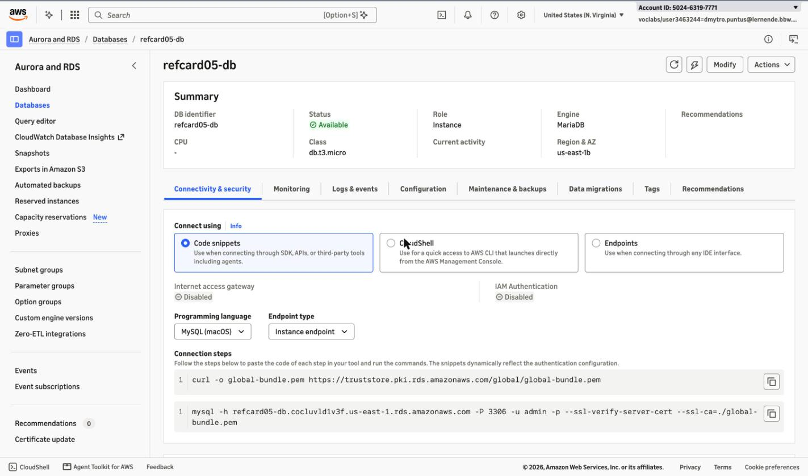

---

## 5. Fotos in Amazon S3 mit Least Privilege

Die Foto-Endpoints aus RefCard04 (`POST/GET /v1/employees/{id}/photo`) sprechen über ein Interface `StorageService` entweder das lokale Dateisystem (Standard, Compose) oder S3 an (`app.storage.type=s3`).

- **Keine Schlüssel im Code oder Image:** der S3-Client nutzt die Default-Credentials-Kette, im ECS-Task also die Rolle des Tasks.
- **Sicherheit:** Dateinamen erzeugt der Server (UUID, Endung aus dem geprüften Content-Type); beim Laden wird der Name gegen ein festes Muster geprüft. Damit sind weder Path Traversal noch fremde S3-Keys möglich. Erlaubt sind nur PNG, JPEG, WebP, maximal 5 MB.
- **Fehlerfälle:** fehlende S3-Rechte (403) ergeben `502` mit klarer Meldung, ein fehlendes Objekt `404`, ein falscher Dateityp `400`. Die Fälle sind mit 7 Unit-Tests (gemockter S3-Client) abgedeckt.
- **IAM Least Privilege im Learner Lab:** `iam:CreateRole` ist gesperrt (ich habe es geprüft: `AccessDenied`), ECS-Tasks dürfen nur `LabRole` verwenden. Eine eigene, schmale Rolle ist daher nicht möglich. Stattdessen beschränke ich den Zugriff **auf der Bucket-Seite**:
  1. `Allow` für `LabRole`: nur `GetObject`, `PutObject`, `DeleteObject` auf die Objekte und `ListBucket` auf diesen Bucket
  2. `Deny` für `LabRole`: jede andere S3-Aktion auf diesen Bucket (`NotAction`)
  3. `Deny` für unverschlüsselten Transport
  4. Bucket privat (Block Public Access an), Verschlüsselung AES-256

  Die Policy steht in `infra/provision.sh`. In einem normalen AWS-Account würde ich dieselben Rechte als eigene Task-Rolle vergeben und die Bucket-Policy als zweite Schicht behalten.
- **Getestet:** Upload und Download über den ALB (als `LabRole` aus dem ECS-Task) funktionieren, die Datei liegt im Bucket. Einen Negativtest mit einer verbotenen Aktion konnte ich nicht ausführen, weil ich `LabRole` im Learner Lab nicht selbst annehmen kann.

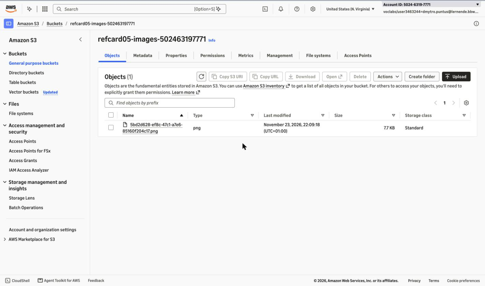
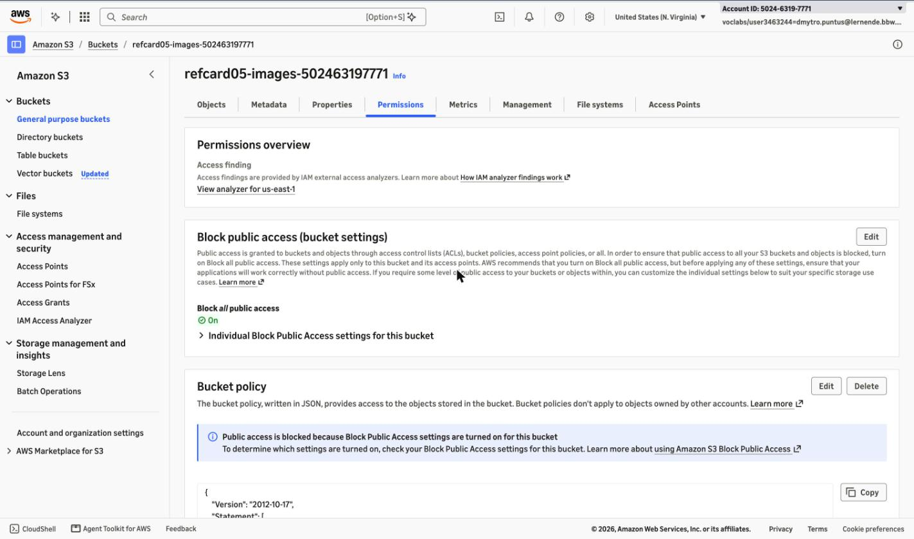
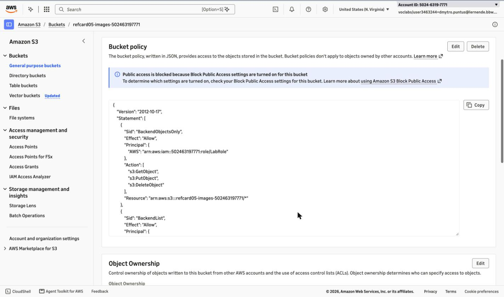

---

## 6. ECS-Deployment mit zwei Services

Zwei unabhängige Fargate-Services im Cluster `refcard05-cluster`, je mit eigenem ECR-Repository, ALB und Target Group:

| | Frontend | Backend |
|---|---|---|
| Container | nginx (Vite-Build) | Spring Boot (JRE 21) |
| Port | 80 | 8080 |
| Ressourcen | 0.25 vCPU / 512 MB | 0.5 vCPU / 1 GB |
| Health-Check (Container) | `GET /healthz` | `GET /actuator/health` |
| Health-Check (ALB) | `/healthz` | `/actuator/health` |

Robustheit:
- Container-Health-Checks in der Task-Definition (ECS ignoriert das `HEALTHCHECK` des Images).
- **Deployment Circuit Breaker mit Rollback:** schlägt ein neues Deployment fehl, geht ECS auf die letzte funktionierende Version zurück.
- `minimumHealthyPercent=100`: bei jedem Update läuft zuerst der neue Task, erst dann wird der alte beendet (kein Ausfall).
- Das Frontend ruft das Backend über `VITE_API_BASE_URL` auf. Vite bettet die URL beim Build ein, deshalb setzt die Pipeline sie als Build-Argument aus einer GitHub-Variable. Das Backend erlaubt per `APP_CORS_ALLOWED_ORIGINS` genau die Frontend-URL.

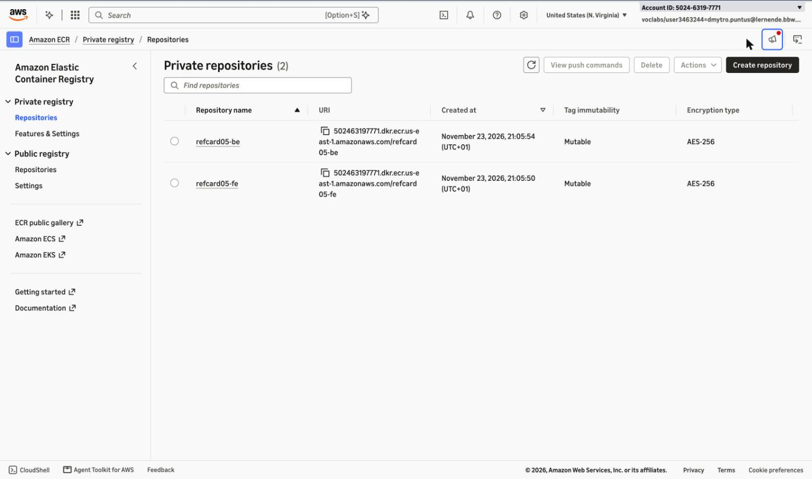
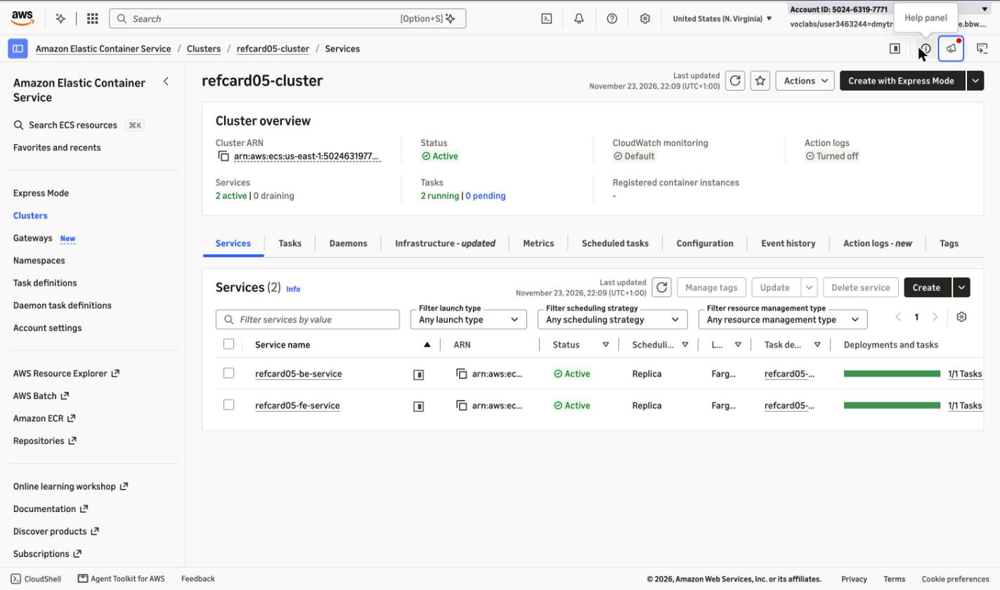
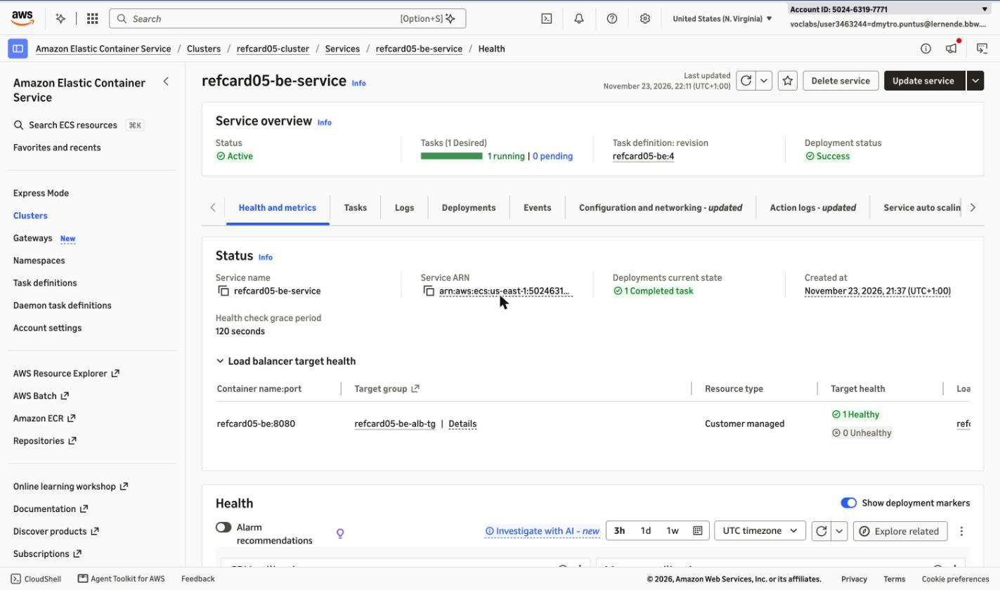
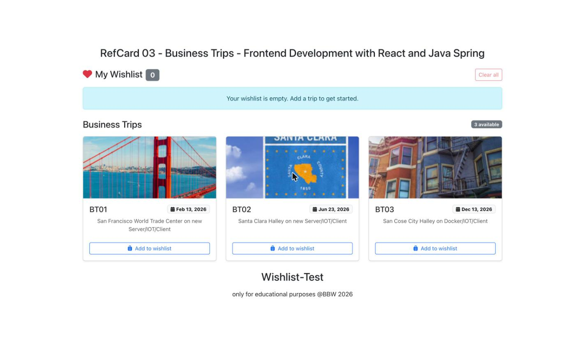

---

## 7. Automatisches Redeploy

Jeder Push auf `main` und jeder Release-Tag baut ein neues Image, trägt es unter einem neuen `sha-…`-Tag in die Task-Definition ein und aktualisiert den ECS-Service. Der Job wartet auf `wait-for-service-stability` und prüft danach mit einem **Smoke-Test**, ob die neue Version antwortet (Backend: `status: UP` inkl. Datenbank, Frontend: `/healthz` und die App-Seite).

Nachgewiesen mit `v1.1.0`: Die Änderung im Frontend (neue nginx-Security-Header) und im Backend (Compose, Dockerfile) führte in beiden Services automatisch zu einer neuen Task-Definition-Revision und einem neuen Container. Danach lieferte das Frontend die neuen Header (`X-Content-Type-Options: nosniff`, `X-Frame-Options: DENY`, `Referrer-Policy`).

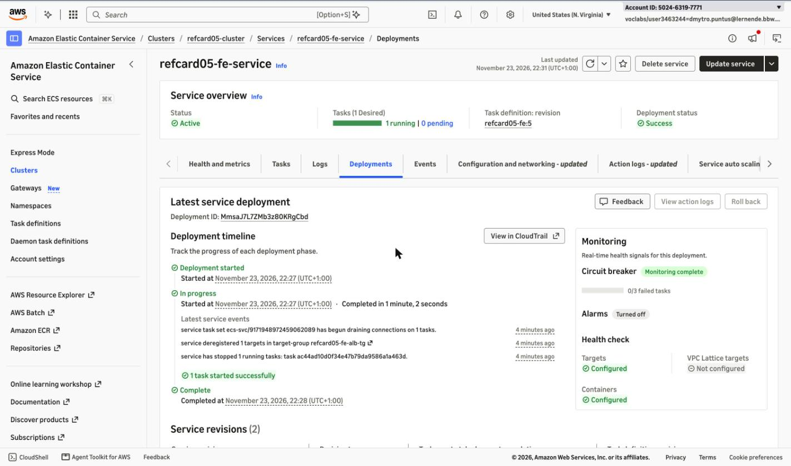
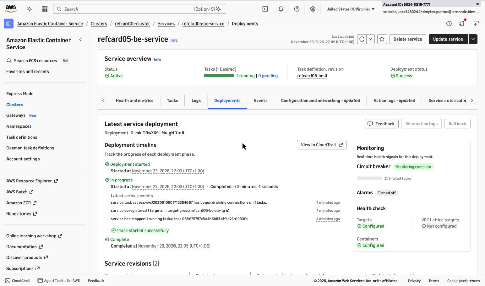
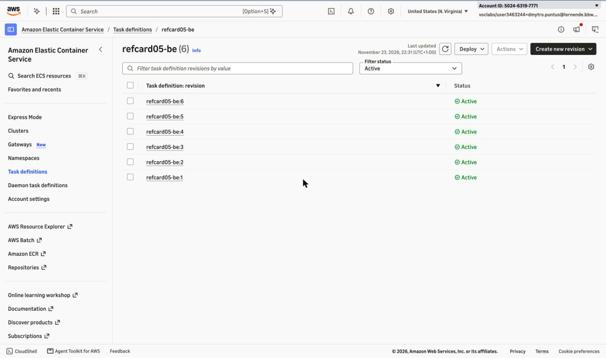

---

## 8. Lokale Entwicklung mit Docker Compose

Im Ordner [`docker-compose-local/`](../docker-compose-local/README.md) des Backend-Repos:

```bash
cd docker-compose-local
cp .env.example .env
docker compose up --build
```

- Drei Services: `mariadb` (Healthcheck) → `backend` (wartet auf gesunde DB) → `frontend` (wartet auf gesundes Backend).
- Das Frontend wird standardmässig direkt aus dem GitHub-Repo gebaut; für eigene Änderungen genügt `FRONTEND_CONTEXT=../../refcard05-fe` in der `.env`.
- Pflichtwerte (`DB_USER`, `DB_PASSWORD`, `DB_ROOT_PASSWORD`) stehen in `.env` (per `.gitignore` ausgeschlossen); fehlen sie, bricht Compose mit einer klaren Meldung ab. Die Datei `.env.example` enthält nur lokale Beispielwerte.
- Daten und Fotos liegen in Docker-Volumes; `docker compose down -v` startet frisch.
- **Kein AWS-Zugang nötig:** lokal läuft die Datenbank als Container und die Fotos landen im Volume.

Von mir von Grund auf getestet: alle drei Container `healthy`, fünf Mitarbeiter, Foto hochladen und herunterladen, Backend neu starten, Daten und Foto bleiben erhalten. Das ursprüngliche `docker/docker-compose.yml` der Vorgabe (hartcodiertes Passwort) habe ich dafür entfernt.

---

## 9. Learner-Lab-Zugangsdaten und OIDC

Im Learner Lab funktionieren weder `iam:CreateRole` noch OIDC. Die Pipelines verwenden daher die temporären Zugangsdaten des „AWS Details"-Panels:

```yaml
- uses: aws-actions/configure-aws-credentials@v4
  with:
    aws-access-key-id: ${{ secrets.AWS_ACCESS_KEY_ID }}
    aws-secret-access-key: ${{ secrets.AWS_SECRET_ACCESS_KEY }}
    aws-session-token: ${{ secrets.AWS_SESSION_TOKEN }}
    aws-region: us-east-1
```

Die drei Werte liegen als **GitHub Secrets** in beiden Repos (Screenshot unten, nur Namen sichtbar). Im Code und in den Workflows stehen keine Schlüssel. Ich habe die Git-Historie beider Repos mit `git grep` auf AWS-Schlüssel, Tokens und private Schlüssel geprüft: nichts gefunden. Einzige Fundstelle eines Passworts war das lokale Entwicklungs-Passwort der Vorgabe in der importierten Startversion (Compose und README); es ist aus dem aktuellen Stand entfernt und war nie ein AWS-Zugang.

**Ablauf bei neuer Lab-Session** (die Tokens laufen nach etwa vier Stunden ab, dann scheitert die Pipeline an „credentials ungültig"):
1. Learner Lab starten, im Panel „AWS Details → AWS CLI → Show" die drei Zeilen kopieren.
2. Sie unter `[default]` in `~/.aws/credentials` einfügen.
3. `./infra/set-github-secrets.sh` ausführen. Das Skript prüft die Credentials mit `aws sts get-caller-identity` und schreibt sie in beide Repos (Werte laufen über stdin, nicht über die Prozessliste).
4. Pipeline neu starten (Re-run). Fehlen die Secrets ganz, baut die Pipeline nur das Image und warnt.

**Vergleich mit OIDC (Produktion):** Mit OIDC bekommt GitHub Actions für jeden Run ein kurzlebiges Token und nimmt eine IAM-Rolle an, die auf Repository und Branch eingeschränkt ist. Es gibt keine gespeicherten Schlüssel, die ablaufen, geleakt oder rotiert werden müssten. Die Rolle kann genau die nötigen Rechte tragen (ECR-Push, ECS-Update). Das ist der Best-Practice-Ansatz. Im Learner Lab nehme ich stattdessen langlebigere Schlüssel in Secrets in Kauf, das ist dort nur wegen der Einschränkungen vertretbar.

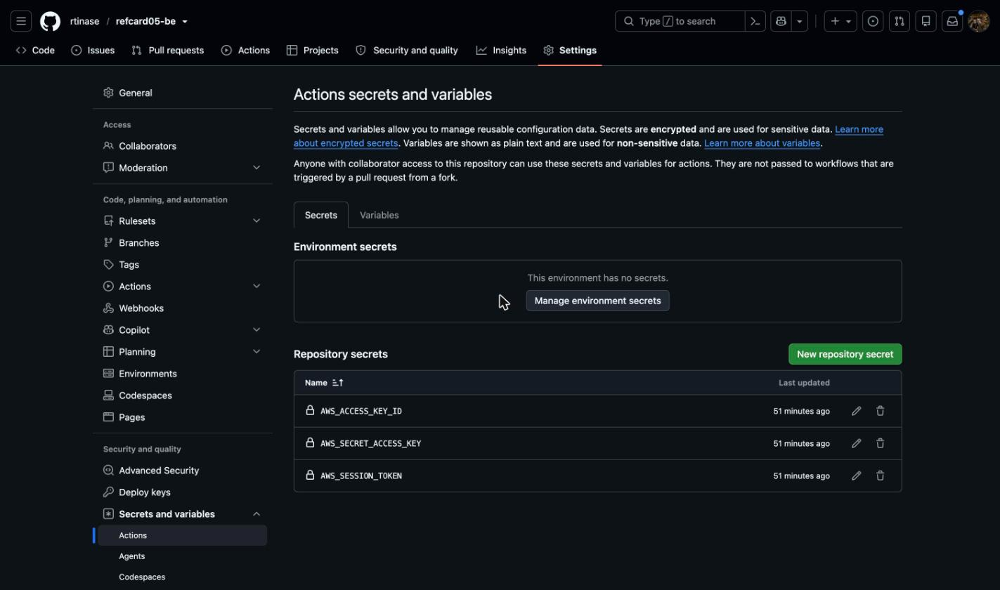

---

## 10. Probleme und Lösungen

| Problem | Ursache | Lösung |
|---|---|---|
| Alle Workflow-Runs `startup_failure` (siehe Run-Liste) | GitHub-Account war wegen eines Billing-Problems gesperrt; auch ein Test-Workflow mit `echo hello` scheiterte | Billing im Account behoben, Runs erneut gestartet |
| Image-Build brach mit HTTP 429 ab | Der Maven Wrapper lud die Maven-Distribution von Maven Central, GitHub-Runner wurden limitiert | Build-Stage nutzt jetzt das Image `maven:3.9-eclipse-temurin-21` |
| Backend-Tasks stoppten sofort (`Connections using insecure transport are prohibited`) | RDS MariaDB 11.8 verlangt TLS | `?sslMode=trust` in der JDBC-URL (verschlüsselt, prüft aber das Zertifikat nicht) |
| Security-Group-Regeln fehlten nach dem ersten Skriptlauf | Argumente in der Funktion `allow` vertauscht, Fehler durch `\|\| true` verdeckt | Funktion korrigiert, es wird nur noch „Regel existiert bereits" ignoriert, Skript erneut ausgeführt |
| Lokal: Lombok-Fehler beim Kompilieren | auf dem Rechner lief JDK 26, das Projekt braucht Java 21 | Tests laufen in einem Container mit JDK 21 (wie in der Pipeline) |

## 11. Bekannte Einschränkungen

- `sslMode=trust` prüft das RDS-Zertifikat nicht. Besser wäre `verify-full` mit dem RDS-CA-Bundle im Image. Der Zugriff ist zusätzlich durch die Security Group begrenzt.
- Die Services sind nur über HTTP erreichbar (kein Zertifikat/Domain im Lab).
- Die Backend-Rolle im Lab ist die gemeinsame `LabRole`. Die Einschränkung erfolgt über die Bucket-Policy, nicht über eine eigene Rolle.
- Die Lab-Umgebung stoppt mit der Session; die Live-URLs funktionieren nur, solange sie läuft. Deshalb die Screenshots.

## 12. Screenshot-Übersicht (alle in `docs/img/`)

| Nachweis | Datei |
|---|---|
| Commits | `18-github-be-commits.jpg` |
| Pull Requests | `17-github-be-pull-requests.jpg` |
| Workflows | `12`, `13`, `14`, `15` |
| ECR | `01`, `02`, `03`, `20` |
| ECS | `04`, `05`, `06`, `21`, `22` |
| S3-Bucket | `08`, `09`, `10` |
| RDS-Instanz | `07-rds-instance.jpg` |
| Website | `11-frontend-website.jpg` |
| Secrets | `19-github-be-secrets.jpg` |
| Tags | `16`, `23` |
